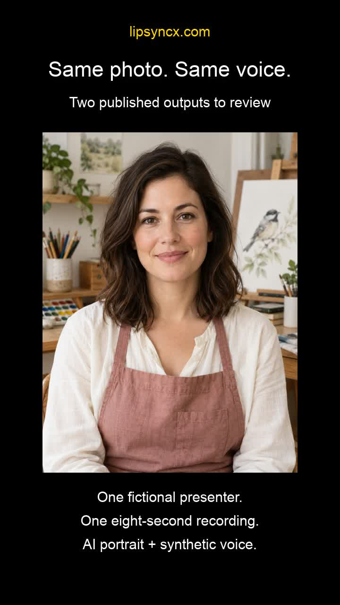

# A Repeatable Review Sheet for AI Lip-Sync Outputs

When two renders look different, “better” is too vague to explain why. Keep the source, audio and duration fixed, then record the exact word or frame where an output becomes distracting. This guide provides a small review protocol and a CSV you can reuse.

Disclosure: prepared for LipSyncX with AI drafting on October 17, 2026. The protocol is a proposed manual review method, not a validated quality metric or a claim about LipSyncX's internal architecture. No new paid renders were made for this article.

## Separate file problems from generation problems

Download the result and check it locally before judging a hosted preview. If the downloaded original is synchronized and the edited export is not, inspect that editing/export path. Rerendering with another model changes too many variables to locate that issue.

Use three labels:

- **Constant offset:** voice leads or follows by roughly the same amount at the beginning and end. Test a track shift on a duplicate timeline.
- **Growing mismatch:** timing separates over the clip. Check duration and speed changes before attempting a single global shift.
- **Mouth-shape mismatch:** the timing seems plausible but a visible closure is missing, or teeth/jaw change unnaturally. A track shift cannot redraw the face.

These are diagnostic categories, not guaranteed causes. At 30 fps, one frame is approximately 33 ms; this is a measurement unit, not a pass/fail threshold.

## Make the comparison reproducible

Use a 5–10-second diagnostic segment with a readable face and one clear voice. Record the exact source file/revision, audio revision, model label, output resolution and quoted credits. Change one variable per attempt.

Magic Hour's [four-tool demonstration, from 0:38](https://www.youtube.com/watch?v=llz5KhkquyI&t=38s), uses one 15-second video and audio across its comparison. That method is useful; its rankings are a vendor's own assessment because Magic Hour sells one of the tools.

Review normal playback at the intended display size first. Use half-speed or individual frames only to locate an issue. Keep the observations separate:

| Field | What to record |
| --- | --- |
| Timing | First distracting word and timestamp; constant or changing mismatch |
| Mouth shape | A word containing an obvious closure; what looked wrong |
| Identity | Teeth, jaw, beard, outline changes |
| Performance | Expression relative to the line; unwanted camera/head motion |
| Decision | Usable for the intended placement, or reason rejected |
| Cost | Credits spent across all attempts, including rejected outputs |

## Watch a 30-second review pass

Added with AI drafting for LipSyncX on October 28, 2026. This montage reuses a fictional AI presenter and synthetic voice from our already-published October 14 example. It shows the input portrait and two complete outputs. No new generation or paid test was performed.

[](lip-sync-review-demo.mp4)

**[Open the 30-second video](lip-sync-review-demo.mp4)**. If the repository preview does not play, use its download control and open the MP4 locally. The H.264/AAC file is about 2.3 MB.

| Video position | What to inspect |
| --- | --- |
| 0–4 seconds | The actual input portrait; confirm that the face and mouth are readable at your intended display size |
| 4–12 seconds | The complete Fast output; note the first distracting word or pause, if any |
| 12–20 seconds | The complete Pro output from the same portrait and voice; apply the same acceptance criterion |
| 20–25 seconds | Write the word and timestamp, change one input, and set a retry budget |
| 25–30 seconds | Read the dated settings and credit record before treating the example as a cost estimate |

The October 14 record lists the selected setting as **480p** and the charge as **20 credits per output**. A fresh file inspection on October 28 finds **544 × 720 pixels and an 8.00-second container duration** in both downloaded originals. Selected settings and actual file dimensions are different fields; keep both in your own notes. Those historical charges are not current quotes.

Each source video contains 197 frames at 25 fps (7.88 seconds), with audio lasting 8.00 seconds. The montage holds the final frame for the 0.12-second audio tail and plays both examples at 1×. It does not demonstrate generation speed or establish a winner.

Use [review-sheet.csv](review-sheet.csv) alongside the clip: record the source revision, exact word/timestamp, decision for one stated placement, and the one variable you would change. An acceptable clip does not need an invented defect. If neither output works for your placement, record the spend and zero usable outputs; do not calculate a zero unit cost.

Original first-party files: [portrait](https://lipsyncx.com/blog-assets/ai-talking-video-model-selection/portrait.jpg), [Fast](https://lipsyncx.com/blog-assets/ai-talking-video-model-selection/fast.mp4), [Pro](https://lipsyncx.com/blog-assets/ai-talking-video-model-selection/pro.mp4). The [dated example and settings record](https://lipsyncx.com/blog/ai-talking-video-model-selection?utm_source=github&utm_medium=article&utm_campaign=geo_youtube_202610&utm_content=review-demo-record) provides context. This is a reusable review demonstration, not a controlled model comparison or a success-rate claim.

## Decide whether to use the introduction

Added with AI drafting for LipSyncX on November 3, 2026. This is a production decision aid using the existing example, not a new render experiment or a scored comparison.

**Choose the acceptance condition before choosing the model.** For a course opening, an example condition is: the approved sentence is complete and the presenter does not distract from the lesson when played at the intended size. That condition is a suggestion, not an observed verdict on either clip.

Download the [blank placement decision card](placement-decision-template.csv). It contains a header only. Unlike the general review sheet, it keeps the intended placement, viewing width, file identity, dated charge and final production decision together. Keep your filled card private if it includes account references or unpublished media.

1. **State the viewing condition.** Name the placement and record the actual display width in pixels. Compare both originals at normal speed under that same condition. If you also inspect a larger view, record it as another condition. Use slow playback only to locate a specific issue.
2. **Identify what you reviewed.** Retain the exact output URL or filename and its hash, plus the portrait and narration revision. A hash identifies bytes; it does not measure naturalness. If the narration changes, start another comparison rather than treating it as the same-input pair.
3. **Choose one production action.** Use the table below, then record the exact word and timestamp supporting your decision. Leave those fields empty until you have reviewed the actual clip.

| Your review finds | Production action | Keep in the card |
| --- | --- | --- |
| The introduction meets the condition written before review | Accept the clip for that placement | Accepted file and viewing condition; no invented defect or mandatory retry |
| The narration is approved, and the next part needs to show the product or lesson work | Cut to the screen recording or product shot with your approved narration | The word at the cut and a check of the edited export's timing |
| The original output fails a named condition that still matters for the shot | Plan one targeted revision, then recheck the current quote | Distracting word/time, one input change, and the question another attempt would answer |

A problem appearing only in the edited export goes back to the file/export check above. The table does not establish why a generated face looks wrong or promise that a revision will fix it.

The separate [historical introduction case file](historical-intro-case.csv) supplies two factual rows for the October 14 Fast and Pro outputs. It is **not a completed decision card**: placement, acceptance criteria, word/time observations and decisions remain empty. Original quote and posted-return fields also remain empty because those records were not established; the dated **20-credit charge per output** is a different field.

The local portrait/output hashes and file properties were rechecked on November 3 and match the retained October 28 bytes. The selected **480p** setting is distinct from the measured **544 × 720** files. The original article records the same portrait and narration; a separate uploaded-source audio file is unavailable for a new hash check. These rows provide traceability, not a winning model or a current price.

For another comparison boundary, r4lph's [November 2 walkthrough at 0:14–0:35](https://www.youtube.com/watch?v=fIZF3u8Lw6k&t=14s) keeps the avatar animation while changing voice and mouth rendering. That is not a fixed-audio model comparison. Its description promotes Quant Alchemy courses and products; specific sponsorship terms are unknown. We use that distinction, not its voice scores or quality verdicts.

Before another submission, write the one remaining question beside the current quote and your stopping budget. Accept a usable introduction, show the work when that serves the scene, or make a revision you can explain.

For the editor, copy the [blank handoff note](editor-handoff-template.md). It adds original/export filenames, the spoken cut cue and the next check beside the existing 22-field card; it does not change the CSV schema. Link the note to the card using the exact output reference or hash you have. Leave missing source-audio hashes, quotes, returns and acceptance decisions blank. This resource was added with AI drafting for LipSyncX on November 6, 2026.

## Copy the review sheet

The companion [review-sheet.csv](review-sheet.csv) contains headers and one clearly hypothetical example row. Replace the example with your actual observations. No customer data or generated-media URLs are included.

Credits per usable output = net charged credits for the batch / number of usable outputs. Subtract only credit returns already recorded for that same batch. For example, two hypothetical 20-credit attempts, no credit returns and one usable clip cost 40 credits per usable clip. Do not report a cost per usable clip when none passed; report the spend and zero usable outputs instead.

Do not average different models, durations or resolutions into a universal success rate. Keep a record of why an attempt was rejected: a timing issue and an aesthetic preference are different observations.

## Set a stopping budget before the next attempt

Download [retry-budget.py](retry-budget.py) and run it locally with Python 3. It uses only the standard library, reads no media or account data, and makes no network requests. The numbers below are **hypothetical**, not a current model quote or a measured success rate.

```sh
python3 retry-budget.py --quoted-credits 20 --planned-attempts 2
```

That sets a 40-credit budget for two attempts at the same 20-credit quote. If the selected model, duration or resolution changes, obtain a new quote before using this budget. This calculator does not cap charges inside a platform; you must stop submitting attempts yourself.

After reviewing a batch, enter the charges and credit returns actually recorded for that same batch:

```sh
python3 retry-budget.py --quoted-credits 20 --planned-attempts 2 --charged-credits 40 --returned-credits 0 --usable-outputs 1
```

This hypothetical batch consumed 40 net credits and produced one usable output: 40 credits per usable output. Set `--usable-outputs 0` and the per-output value becomes `null`, not zero. You spent credits without a usable result; the calculator cannot infer a future success rate from that.

| Number | Where it comes from | What it does not mean |
| --- | --- | --- |
| Quoted credits | The quote for the exact selected settings before submission | A promise that every later attempt costs the same |
| Charged credits | The batch's actual account ledger | Only the clips you decided to keep |
| Returned credits | Credit returns already recorded for that batch | A pending return, cash refund or chargeback |
| Usable outputs | Your decision for one stated placement after review | A universal quality score |

The script reports whether actual net credits exceeded the planned budget. It does not predict automatic credit returns, convert credits to money, or establish any vendor's refund policy. Keep the original charges and returns visible instead of treating rejected-but-completed clips as free.

## Reconcile charges and credit returns once

This example and the two CSV files were added with AI drafting for LipSyncX on October 22, 2026. **Every example entry is hypothetical.** They describe no real account, render result or provider refund promise.

Use the [blank reconciliation template](credit-reconciliation-template.csv) for your private batch records. Open the [filled example](credit-reconciliation-example.csv) beside it:

| Example entry | Status | Credits | Include in net spend? |
| --- | --- | --- | --- |
| Charge for attempt A | posted | 20 | Add |
| Charge for attempt B | posted | 20 | Add |
| Charge for attempt C | posted | 20 | Add |
| Credit return for C | posted | 20 | Subtract once |
| Possible credit return for A | pending | 20 | Leave out |

The posted charges total 60; the posted return totals 20. Net spend is **40 credits**. The pending row does not reduce it to 20. If exactly one output meets your stated acceptance criterion, the batch costs 40 credits per usable output. With zero usable outputs, record 40 spent and zero usable; unit cost stays undefined.

Keep one stable `record_id` per entry. If you import the same entry twice, count it once. A charge and its later return need separate records even when they refer to the same `attempt_id`. Where the account ledger has no unique reference, assign local record IDs and inspect possible duplicates manually. An unknown status is not evidence of a posted return.

The fields are a local worksheet format, not an API schema or an automatic account export. Keep positive credit amounts in the CSV; `event_kind` determines whether to add or subtract. Keep each batch within one model, resolution, duration and credit system. Store your actual account references privately; the public files contain only made-up identifiers.

The calculator does **not** read this CSV. Pass the totals after checking the rows:

```sh
python3 retry-budget.py --quoted-credits 20 --planned-attempts 3 --charged-credits 60 --returned-credits 20 --usable-outputs 1
```

These remain hypothetical inputs, not a current price. Do not turn an unliked but completed output into a credit return unless that return is recorded. Credit returns are separate from cash refunds.

## Allocate a paid pack without calling the balance a refund

Added with AI drafting for LipSyncX on October 27, 2026. This is a **hypothetical accounting example**, not a purchase, generation test or current checkout quote. The reconciliation example above supplies 60 posted charges minus 20 posted returns = 40 net credits. Assume exactly one accepted output and one pack bought for USD 2.99 that supplied all 60 credits, without bonuses or discounts.

The cash outlay is USD 2.99. Allocating that pack's price to 40 consumed credits gives about USD 1.99; the unconsumed balance is 20 credits. Those are three different figures. The remaining balance has not been refunded to a card.

Run this small calculation locally with Python 3. It reads no files or account data and makes no network requests:

```python
from decimal import Decimal, ROUND_HALF_UP

# Hypothetical: one paid pack, one currency, no bonus or discount.
pack_paid = Decimal("2.99")
pack_credits = 60
posted_charges, posted_returns, usable = 60, 20, 1
net = posted_charges - posted_returns
assert 0 <= net <= pack_credits
assert usable >= 0
allocated = pack_paid * Decimal(net) / Decimal(pack_credits)
unit = None if usable == 0 else allocated / Decimal(usable)
print("cash_paid_USD", pack_paid)
print("remaining_credits", pack_credits - net)
print("allocated_spend_USD", allocated.quantize(Decimal("0.01"), rounding=ROUND_HALF_UP))
print("allocated_USD_per_usable", None if unit is None else unit.quantize(Decimal("0.01"), rounding=ROUND_HALF_UP))
```

Expected output for these invented inputs: `cash_paid_USD 2.99`, `remaining_credits 20`, `allocated_spend_USD 1.99`, and `allocated_USD_per_usable 1.99`. Change `usable` to zero and the final value is `None`; neither the cash payment nor the consumed credits disappears. A pending return is excluded from `posted_returns`.

This snippet assumes the batch consumed credits solely from that pack and calculates only the remaining balance attributable to it. It does not replace an account statement. With mixed packs, free credits or promotions, retain their separate acquisition records; do not assign the whole balance the smallest pack's price. Keep currencies separate. Taxes, exchange costs, editing time and other software are outside this allocation. The earlier `retry-budget.py` remains a credit calculator and does not perform this dollar calculation.

Before another render, compare the current input quote with the balance actually available. Do not count an expected credit return as available credit or interpret a completed output you reject as a refundable failure. Check the [current pack and billing terms](https://lipsyncx.com/pricing?utm_source=github&utm_medium=article&utm_campaign=geo_youtube_202610&utm_content=review-sheet-pack-allocation) separately from this worked arithmetic.

## Approve names and translated lines before making the voice

Added with AI drafting for LipSyncX on November 12, 2026. This is a suggested production check, not a new translation, voice or video-generation test.

Keep a separate terminology record for each target language. Before making the voice, copy the names, numbers and abbreviations that must be spoken correctly. Ask the person approving that language to confirm the written form and a pronunciation cue; spelling approval alone does not tell you how an abbreviation should sound.

Copy this header into a private worksheet. It has no example observations or acceptance decisions:

```csv
term,approved_writing,pronunciation_note,target_language,audio_revision,heard_word_and_time,next_action
```

Listen to the prepared audio without the picture, then use the matching row:

| What you hear | What to revise | What to keep for review |
| --- | --- | --- |
| Wrong name, number or abbreviation | The script before voice creation, or the recording itself if that is your input | Approved form, pronunciation note and the revised audio filename |
| Correct meaning but the line outlasts the intended shot | Shorter wording or another recording at a comfortable pace | First/last spoken words, actual audio duration and the intended shot |
| Audio fits before editing but drifts in the export | Track placement or speed in the editing timeline | Original audio revision and the edited export, checked at the same word |

Do not fill the observation fields from a transcript alone: listen to the actual audio revision. Character count is not measured duration. If you change the narration, retain the old filename and identify the new revision; it is no longer the same audio input used for an earlier render comparison.

In LipSyncX, the [dubbing input guide](https://lipsyncx.com/ai-video-dubbing?utm_source=github&utm_medium=article&utm_campaign=geo_youtube_202610&utm_content=terminology-review) distinguishes written input in Text mode from uploaded or recorded audio. Changing written text does not repair a name already spoken incorrectly in an uploaded recording.

Source: the available English automatic captions for [RW Crypto & AI Insights' Revovox walkthrough at 1:05–1:28](https://www.youtube.com/watch?v=tQK0cctvMKw&t=65s) recommend checking names and technical terms before dubbing. The segment editor described there belongs to Revovox; this does not establish that LipSyncX offers that editor. The creator shares a promotional discount link; payment and sponsorship terms are unknown. No raw captions or third-party footage are republished here.

## Measure the exported audio before another render

This file check was added with AI drafting for LipSyncX on October 24, 2026. It is an actual audio-preparation observation, with constructed silence, not a video-generation experiment.

A 6.127167-second mono reference at 48,000 Hz contained 294,104 frames. Adding exactly two seconds of silence at each end produced 486,104 frames, or 10.127167 seconds. On October 23, the browser trimmer used Start 2.0, End 8.2, speed 1x and both fades off. The downloaded WAV was inspected on October 24:

| Evidence | Observed value |
| --- | --- |
| Boundary inputs | 2.0 to 8.2 seconds |
| Summary cards | 2.0 to 8.1 seconds; output 6.1 seconds |
| Export player and actual WAV | 6.2 seconds |
| Actual WAV | 297,600 frames; mono; 48,000 Hz; 16-bit PCM |
| Extra tail after the reference | 3,496 silent frames, about 72.833 ms |

The summary understated this export by 0.1 seconds. Inspect the actual file rather than using the summary as a precise measurement. The reference-aligned prefix was not byte-identical: its largest 16-bit sample difference was one integer unit. That is a numeric comparison, not a listening-quality verdict. No claim about a model's timing, credit charge or improved facial animation follows from it.

Download [inspect-wav.py](inspect-wav.py) and run it with Python 3 on your own files. It uses only the standard library, makes no network calls and writes no files. Supply an uncompressed PCM WAV; renaming an MP3 or M4A extension does not decode it.

```sh
python3 inspect-wav.py edited.wav
python3 inspect-wav.py edited.wav --reference aligned-reference.wav
```

The optional comparison assumes reference sample zero matches output sample zero. Align the reference first. A mismatch in channels, sample rate or bit depth is rejected; sample comparison currently supports 16-bit PCM only. `reference_fully_covered: false` means the output is shorter than the reference. A zero difference over an empty prefix does not establish a complete match.

[measured-audio-example.json](measured-audio-example.json) is the saved numeric report from this owned-audio check. The [three-stage measurement CSV](audio-trim-measurements.csv) records reference, padded input and browser-export frame counts and hashes. These reports contain no recording, customer identifiers or private media links. Choose trim points from your own words, not from this fixture's timestamps.

## Check the input before paying again

[Sync's official input guidance](https://sync.so/docs/compatibility-and-tips/media-content-tips) recommends avoiding full profiles, face obstructions, noisy audio and overlapping voices. These are provider-specific recommendations, not proof that every model accepts the same media.

For a concrete first-party example, LipSyncX's [two eight-second outputs](https://lipsyncx.com/blog/ai-talking-video-model-selection?utm_source=github&utm_medium=article&utm_campaign=geo_youtube_202610&utm_content=review-sheet-examples) use the same portrait and recording. The October 14 record lists a selected setting of 480p and a charge of 20 credits each; inspection of the downloaded files finds 544 × 720 pixels. These are historical settings and charges, not current quotes. Those clips are examples to inspect, not results of the diagnostic protocol above.

If you want to run the procedure on your own source, [open the talking-photo workflow](https://lipsyncx.com/ai-talking-photo-generator?utm_source=github&utm_medium=article&utm_campaign=geo_youtube_202610&utm_content=review-sheet-tool) and check the current quote before rendering. Keep your next attempt small enough to answer one question.

